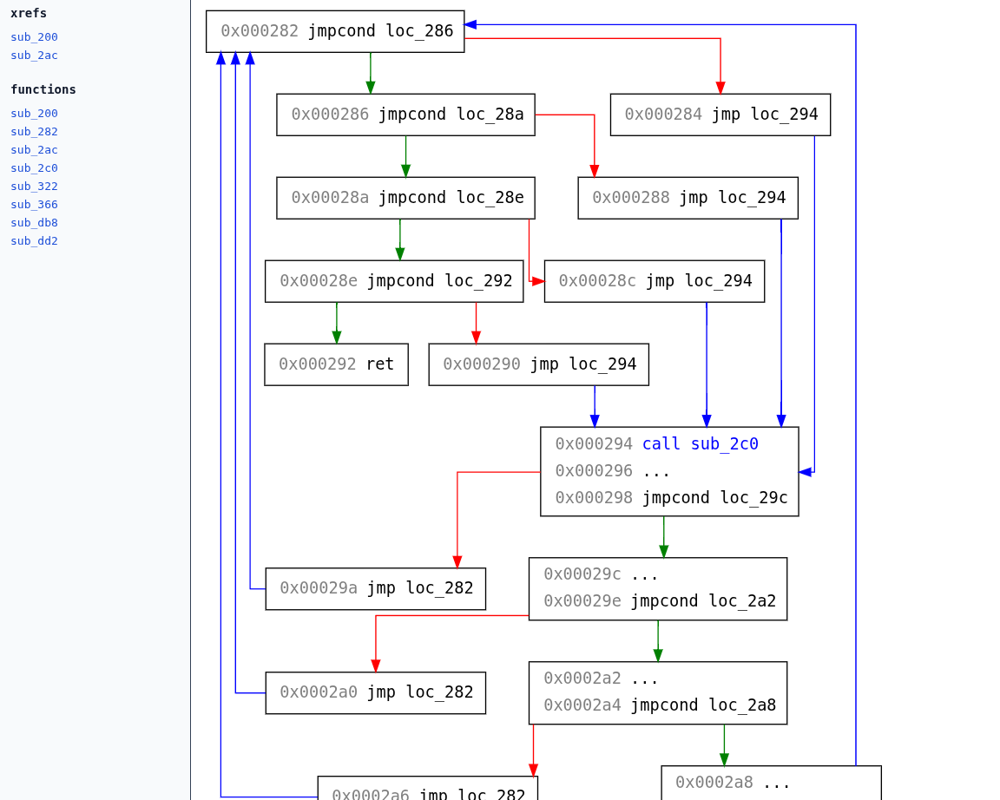

# libCFG

Language-agnostic Python library for building and rendering control flow graphs with minimal intermediate language.

The CFGs are svg files generated with graphviz. HTML wrappers are included for easy navigation.

## Requirements

On Debian/Ubuntu

```bash
sudo apt install graphviz
```
On macOS with Homebrew:

```bash
brew install graphviz
```

## Installation


```bash
python -m pip install git+https://github.com/purupuddu/libCFG.git
```

With `uv`:

```bash
uv add git+https://github.com/purupuddu/libCFG.git
```

## Usage

All you need to do is provide a python function which acts as disassembler and returns instructions in the intermediate language. 

The instructions are of these kinds:
- `Instruction(nexti, "disassembled")` : a default for any non-control-flow instruction
- `Call(nexti, target)`
- `Ret("name")` : also for cases such as exit / jmp $reg, where you don't have a known next address
- `Jump(target)`
- `CondJump(cond_true, cond_false, "jXX loc_YYY")`

The disassembler takes an address and returns the instruction at that address.

Calling 
```
libcfg.CFG(disassembler:Callable[[bytes, int], BaseInstruction], entry_points:List[int])
```
generates a directory containing an html+svg for each function. 

## Example: Chip8 disassembler
Here is a minimal, incomplete example of a chip8 disassembler
```python
# uses padding to have consistent addresses
bin = bytes(0x200) + open("main.bin", "rb").read()

def disassembler(addr:int):
    """Minimal chip8 example. Only disassembles what's relevant for cfg generation.
    Any other instruction will be named "TEMP"
    """
    global bin

    op = bin[addr:addr+2]
    opi = op[0]<<8 | op[1]
    
    if op == b"\x00\xee":
        return Ret()
    if op == b"\x00\xfd":
        return Ret(f"exit")
    
    if opi & 0xf000 == 0x1000:
        return Jump(opi & 0xfff)
    if opi & 0xf000 == 0x2000:
        return Call(addr+2, opi & 0xfff)
    if 0x3000 <= (opi & 0xf000) <= 0x5000: 
        # This is a simple way of grouping "conditional skip" instructions
        # additional casework to distinguish the condition+parameters of the skip is missing
        return CondJump(cond_true=addr+4, cond_false=addr+2) # condjump models skip instructions
    # other instructions which are not relevant to the CFG should be handled here 
    return Instruction(addr+2, s="...")

CFG(disassembler, [0x200])
```
### Example output
